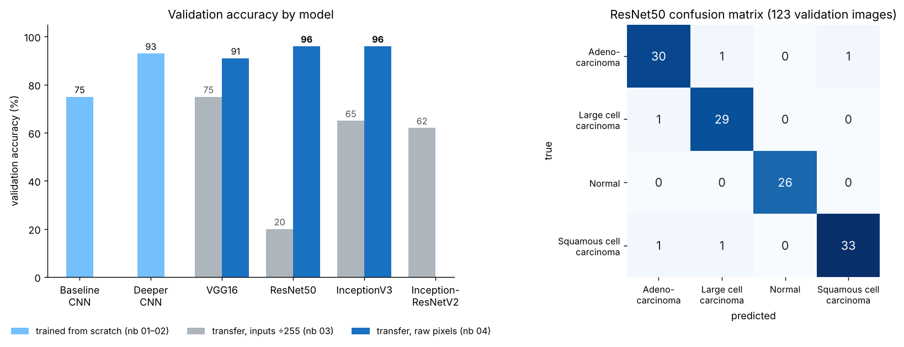

# Lung Cancer Detection from Chest CT Scans (Deep Learning)

Classifies chest CT slices into **adenocarcinoma**, **large cell carcinoma**, **squamous cell carcinoma**, or **normal**. I trained CNNs from scratch, compared four ImageNet backbones for transfer learning, and served the best model in a Flask web app with a JSON API.

   

> ⚠️ Portfolio/research project on a small public dataset. **Not a medical device and not for diagnosis.**

<p align="center"></p>

## Results

| Notebook | Approach | Validation accuracy |
|---|---|---|
| [01](notebooks/01_baseline_cnn.ipynb) | Small CNN from scratch | 75% |
| [02](notebooks/02_deeper_cnn.ipynb) | 4-block CNN from scratch | 93% |
| [03](notebooks/03_transfer_learning_v1.ipynb) | VGG16 / ResNet50 / InceptionV3 / InceptionResNetV2, inputs ÷255 | 75% / **20%** / 65% / 62% |
| [04](notebooks/04_transfer_learning_v2.ipynb) | Same backbones, correct input range | 91% / **96%** / 96% |

**Best model:** ResNet50 transfer learning, **96% accuracy and 0.96 macro F1**. *Normal* scans are perfectly separated, and the 5 remaining errors are confusions between cancer subtypes.

### The key lesson: preprocessing must match the pretrained weights

The first transfer-learning attempt scaled pixels to 0–1. Keras ImageNet models expect a different input range: 0–255 with per-channel mean subtraction for ResNet50 and VGG16, and −1 to 1 for Inception. With the wrong scale, ResNet50 collapsed to predicting *normal* for almost every image: 99% training accuracy but **20%** validation accuracy. Using the input range the weights were trained on brought it to **96%**. `train.py` and the web app now call the backbone's own `preprocess_input`, and the app reads which preprocessing to use from a JSON file saved alongside the model, so inference always matches training.

### Caveats

The notebook numbers come from a single random 80/20 split of the dataset's `train/` folder (613 images) with no fixed seed, so treat them as estimates. `train.py` fixes this. It trains on `train/`, selects the model on `valid/`, and reports accuracy on the separate `test/` split.

## Project structure

```
notebooks/            experiments 01–04 (with findings at the end of each)
train.py              reproducible training: ResNet50/VGG16/InceptionV3, augmentation,
                      head training + fine-tuning, test-set report, confusion matrix
lungct.py             shared inference code (image loading, preprocessing, Classifier)
app.py                Flask web app + JSON API
templates/index.html  upload page with class probabilities
tests/                pytest suite (runs without TensorFlow using a stub model)
azure-pipelines.yml   CI: runs the tests on Python 3.10–3.12
```

## Quick start

```bash
git clone https://github.com/vamshiteja999/DETECTION-OF-LUNG-CANCER-USING---ML.git
cd DETECTION-OF-LUNG-CANCER-USING---ML
python -m venv .venv && source .venv/bin/activate
pip install -r requirements.txt
```

**1. Get the data.** Download [Chest CT-Scan images](https://www.kaggle.com/datasets/mohamedhanyyy/chest-ctscan-images) and unzip it so you have `data/train`, `data/valid` and `data/test`. Folder-name differences between the splits are handled automatically.

**2. Train** (a GPU is recommended; a CPU works but is slow):

```bash
python train.py --data data --backbone resnet50
# -> models/lung_ct_resnet50.keras, .json, metrics.json, confusion_matrix.png
```

**3. Run the app:**

```bash
python app.py        # http://127.0.0.1:5000
```

**API:**

```bash
curl -F "image=@scan.png" http://127.0.0.1:5000/api/predict
# {"label": "adenocarcinoma", "display_name": "Adenocarcinoma", "confidence": 0.93,
#  "probabilities": [{"name": "Adenocarcinoma", "probability": 0.93}, ...]}
```

**Tests** (these don't need TensorFlow or a trained model):

```bash
pip install -r requirements-ci.txt
pytest
```

## Possible next steps

- Grad-CAM heatmaps to show which regions drive each prediction
- k-fold cross-validation and confidence intervals, given the small dataset
- Patient-level splits, if patient IDs become available, to rule out leakage between near-identical slices
